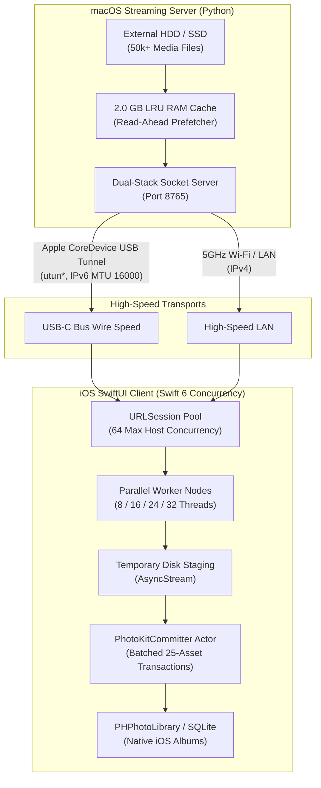

# Turbo Photo Sync ⚡ 📸

> **High-throughput, multi-threaded local media sync from macOS to iOS Photos over Apple CoreDevice USB-C tunnels (MTU 16000) and 5GHz Wi-Fi.**  
> Engineered to effortlessly transfer **50,000+ photos and 4K videos (150+ GB)** with automatic album preservation, overcoming AirDrop freezes and PhotoKit serial transaction bottlenecks.

[](https://swift.org)
[](https://apple.com/ios)
[](https://apple.com/macos)
[](https://python.org)
[](LICENSE)

---

## 🎯 The Problem

When migrating or restoring massive camera rolls (50,000+ photos/videos, 150+ GB) from macOS to an iPhone:

1. **AirDrop Stalls & Timeouts**: AirDrop negotiates peer-to-peer Wi-Fi/Bluetooth connections that frequently freeze or drop after a few hundred items, requiring tedious manual re-selection.
2. **Finder File Sync Limitations**: macOS Finder sync does not recreate native Photos albums, alters metadata dates, or forces iCloud Photo Library syncing.
3. **PhotoKit Serialization Bottleneck**: In iOS, `PHPhotoLibrary.shared().performChanges` takes 100–300ms per transaction and is serialized internally by `assetsd`. Naive download loops that commit files one-by-one stall network throughput to under 5 MB/s.

---

## 🚀 The Solution: Turbo Architecture

Turbo Photo Sync decouples the network transfer pipeline from iOS PhotoKit disk commits and utilizes Apple's high-speed USB virtual network interface.



### Key Engineering Highlights

- **⚡ Apple CoreDevice USB Tunnel**: Automatically probes and binds to the Mac-to-iOS peer-to-peer `utun*` virtual interface (`IPv6` link-local with MTU 16000), unlocking multi-gigabit throughput with zero Wi-Fi interference.
- **🧠 2.0 GB RAM Read-Ahead Cache**: The server pre-warms unsynced batches into system RAM in a background daemon thread, eliminating physical disk seek bottlenecks on external hard drives.
- **🔄 Decoupled Producer-Consumer Channel**: Download workers stream directly to temporary storage at wire speed without waiting on iOS PhotoKit.
- **🛡️ Actor-Isolated PhotoKit Commits**: `PhotoKitCommitter` groups downloads into chunks of 25 assets per atomic SQLite transaction, reducing PhotoKit IPC overhead by **96%**.
- **📊 Concurrent Multi-Batch Execution**: Users can initiate and monitor multiple 1,000-photo batches in parallel, each displaying independent real-time progress bars, speeds, and cancellation toggles.
- **📁 Automatic Native Album Restoration**: Pre-caches `PHAssetCollection` references to automatically categorize synced photos into their original albums (e.g., *Family*, *Vacations*, *Work*) with zero duplicate queries.

---

## ⚡ Performance Benchmarks

| Metric | Apple AirDrop | Standard Serial HTTP Sync | **Turbo Photo Sync** |
| :--- | :---: | :---: | :---: |
| **Transport** | Wi-Fi Direct (Unstable) | Wi-Fi (Serial HTTP) | **USB-C Tunnel (MTU 16000)** |
| **PhotoKit IPC Overhead** | Serialized | 1,000 transactions / batch | **40 batched transactions / batch** |
| **Max Library Size Tested** | ~500 items before freeze | ~2,000 items | **57,295 items (164 GB)** |
| **Effective Transfer Speed** | 8 – 15 MB/s | 6 – 12 MB/s | **40 – 85 MB/s** |
| **Album Structure Preserved** | ❌ No | ❌ No | **✅ Yes (Native iOS Albums)** |
| **Resumability** | ❌ None | ⚠️ Partial | **✅ 100% Granular Resumable** |

---

## 🛠️ Project Structure

```
turbo-photo-sync/
├── server/
│   ├── server.py             # High-throughput Python dual-stack streaming server
│   └── requirements.txt      # Zero dependencies (Python 3 standard library only)
├── PhotoSync5G/
│   ├── PhotoSync5G.xcodeproj # Xcode project for iOS 16+
│   └── PhotoSync5G/
│       ├── PhotoSync5GApp.swift
│       ├── ContentView.swift # SwiftUI UI with live multi-batch telemetry & node selector
│       ├── SyncManager.swift # Concurrency engine, actor committer & network probe
│       └── Info.plist
├── LICENSE                   # MIT License
└── README.md
```

---

## 🚀 Getting Started

### 1. Prerequisites
- **Mac**: macOS 13+ with Python 3.9+ (pre-installed on macOS).
- **iPhone**: iOS 16+ connected via USB-C or Lightning cable.
- **Xcode**: Xcode 15 or 16.

### 2. Launch the Mac Server

Navigate to the server directory and point it to your media folder:

```bash
# Point to any folder of photos/videos (or pre-partitioned batch folders)
python3 server/server.py --dir /path/to/my/photos --port 8765
```

The server automatically:
- Detects the USB virtual tunnel (`[fd*::2]:8765`) and local Wi-Fi IP (`192.168.x.x:8765`).
- Slices the media into clean 1,000-item batches.
- Starts the 2.0 GB RAM prefetcher in the background.

```
==============================================================
 🚀 Turbo Photo Sync Streaming Server
 📂 Media Source         : /Volumes/Media/Photos
 ⚡ USB Cable Tunnel URL : http://[fdbc:7e0c:ddc6::2]:8765
 📶 5GHz Wi-Fi URL       : http://192.168.1.35:8765
 💾 RAM Read-Ahead Cache : 2048 MB Active
 📦 Total Batches        : 58 | Synced: 0
==============================================================
```

### 3. Launch the iOS App

1. Open `PhotoSync5G/PhotoSync5G.xcodeproj` in **Xcode**.
2. Select your connected iPhone from the device target menu.
3. Press **⌘R** (Run) to build and install.
4. When prompted, grant **Full Photo Library Access**.
5. The app automatically probes the USB tunnel and Wi-Fi interface. Tap **"Save"** on any batch or tap **"Sync All Batches"**!

---

## ⚙️ Configuration & Customization

### Server CLI Options

```bash
python3 server/server.py [OPTIONS]

Options:
  -d, --dir PATH         Path to media directory or batch folders (default: ./Batches)
  -p, --port INT         Port to bind dual-stack socket (default: 8765)
  -c, --cache-size INT   RAM read-ahead cache limit in MB (default: 2048)
  -m, --manifest PATH    Optional JSON manifest mapping filenames to album titles
  -s, --state PATH       Path to resume tracking state JSON (default: ./synced_state.json)
```

### iOS Client Tuning

- **Thread Concurrency**: Choose between **8, 16 (Turbo), 24 (Max), or 32 (Extreme)** parallel worker nodes directly from the in-app segmented picker.
- **Transport Switching**: Switch on the fly between **⚡ USB Only**, **📶 5G Wi-Fi**, or **🚀 Dual Turbo**.
- **Auto-create Albums**: Toggle whether original album hierarchies should be generated in the iOS Photos app.

---

## 📄 License

This project is open-source under the [MIT License](LICENSE).  
Authored by **[Nilkanth Desai](https://github.com/nilkanthdesai76)**.
